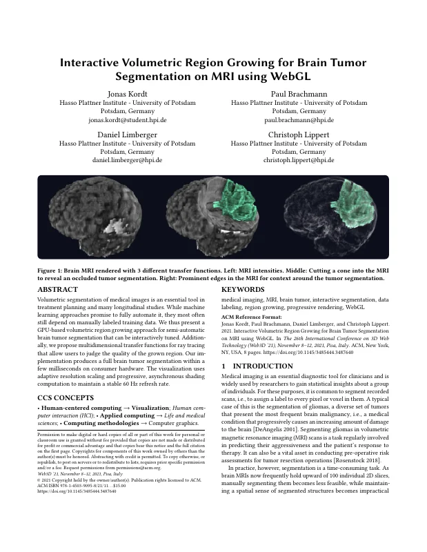
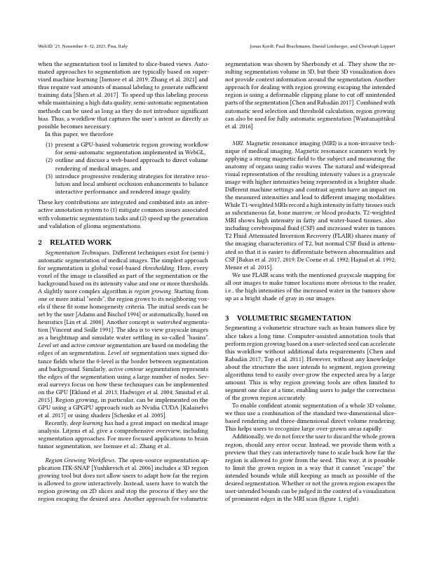
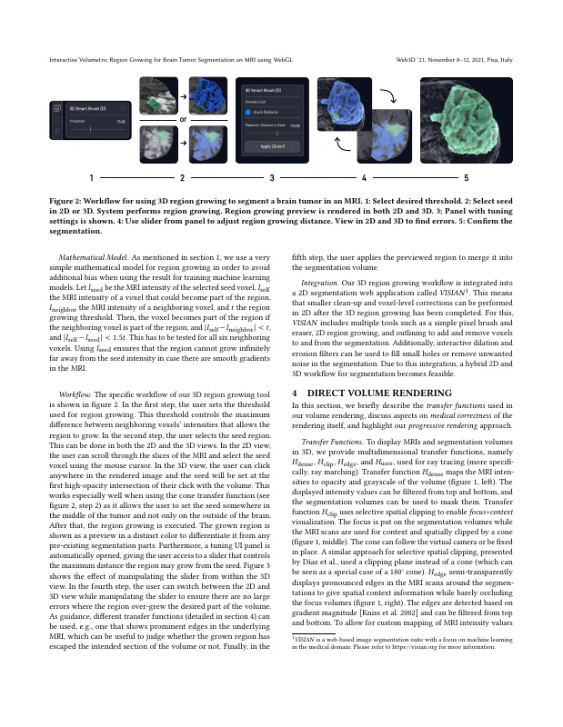
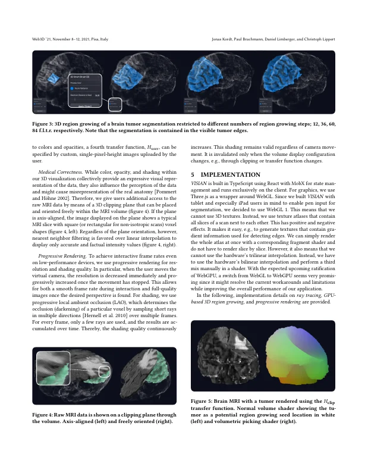
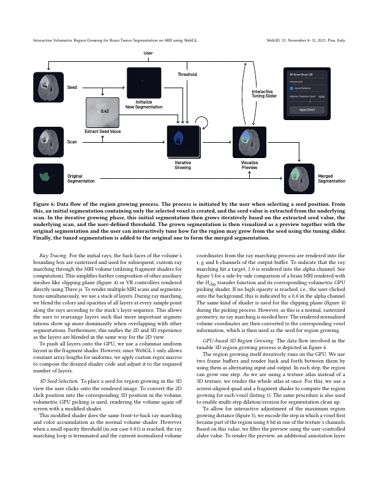
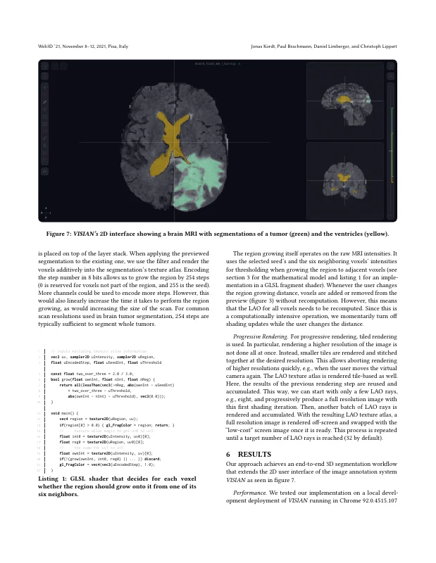
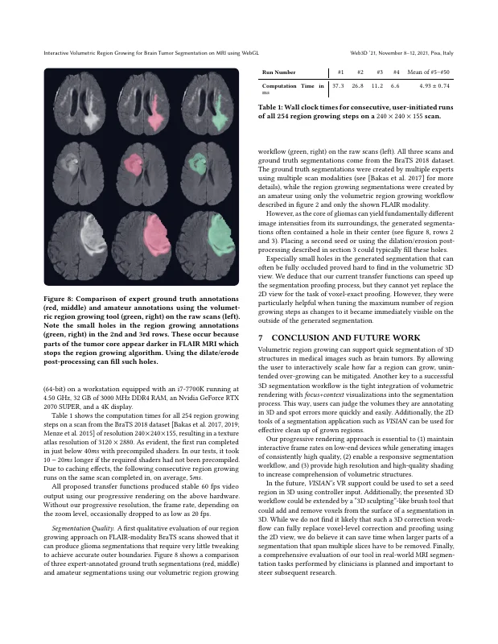
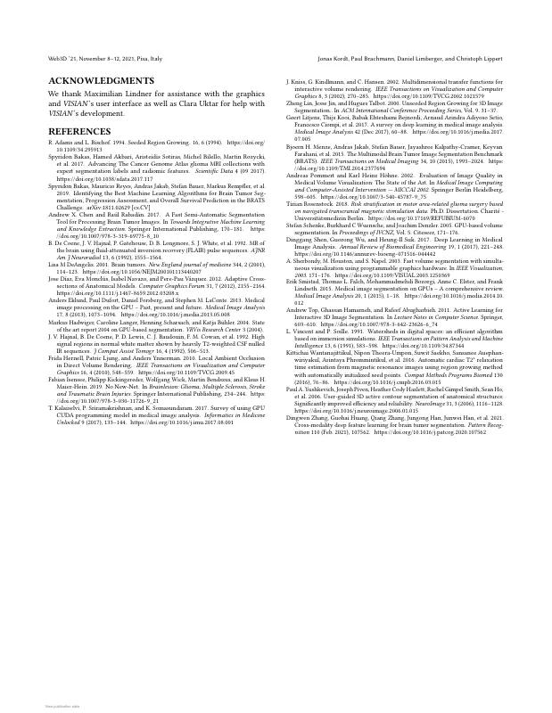

# Interactive Volumetric Region Growing for Brain Tumor Segmentation on MRI using WebGL

Jonas Kordt, [Paul Brachmann](https://orcid.org/0009-0000-6653-2999), [Daniel Limberger](https://orcid.org/0000-0002-9111-4809), and [Christoph Lippert](https://orcid.org/0000-0001-6363-2556)

*Proceedings of the 26th International Conference on 3D Web Technology (Web3D '21)*, November 8–12, 2021, Pisa, Italy. ACM, pp. 2:1–8.

DOI: [10.1145/3485444.3487640](https://doi.org/10.1145/3485444.3487640) · Author's version: [Zenodo](https://doi.org/10.5281/zenodo.24101027) · [ResearchGate](https://www.researchgate.net/publication/356974519)

> Volumetric segmentation of medical images is an essential tool in treatment planning and many longitudinal studies.
> While machine learning approaches promise to fully automate it, they most often still depend on manually labeled training data.
> We thus present a GPU-based volumetric region growing approach for semi-automatic brain tumor segmentation that can be interactively tuned.
> Additionally, we propose multidimensional transfer functions for ray tracing that allow users to judge the quality of the grown region.
> Our implementation produces a full brain tumor segmentation within a few milliseconds on consumer hardware.
> The visualization uses adaptive resolution scaling and progressive, asynchronous shading computation to maintain a stable 60 Hz refresh rate.

<p><a href="kordt2021-tumor-segmentation-as-submitted.pdf"></a> <a href="kordt2021-tumor-segmentation-as-submitted.pdf"></a> <a href="kordt2021-tumor-segmentation-as-submitted.pdf"></a> <a href="kordt2021-tumor-segmentation-as-submitted.pdf"></a></p>
<details><summary>Remaining 4 pages</summary><p><a href="kordt2021-tumor-segmentation-as-submitted.pdf"></a> <a href="kordt2021-tumor-segmentation-as-submitted.pdf"></a> <a href="kordt2021-tumor-segmentation-as-submitted.pdf"></a> <a href="kordt2021-tumor-segmentation-as-submitted.pdf"></a></p></details>

## Contents

- [`src/`](src/) – LaTeX sources of the camera-ready version (ACM `acmart` v1.78, sigconf)
- [`kordt2021-tumor-segmentation-as-submitted.pdf`](kordt2021-tumor-segmentation-as-submitted.pdf) – camera-ready PDF (author build of 2021-10-01)
- [`build.sh`](build.sh) – reproducible build with TeX Live 2018 (podman or docker)
- [`preview/`](preview/) – page previews for this README

## Build

```bash
./build.sh        # → build/main.pdf
```

The paper was compiled in October 2021 with pdfTeX 1.40.19 (TeX Live 2018), hence the TeX Live 2018 container.
On `main`, the build produces the revised version (`v1.1-revised`); check out `v1.0-camera-ready` for the camera-ready version.
For `v1.0-camera-ready`, pages 1–5 and 8 are reproduced pixel-identically, the text is identical throughout.
One difference remains on pages 6–7: in the camera-ready PDF, the caption of Listing 1 is set narrower (3 lines instead of 2), so the paragraph "The region growing itself operates …" moves from the right column above the listing, and the column ends on pages 6–7 shift by one or two lines.
The Overleaf state these sources come from apparently differs from the camera-ready in the listing/caption setup; TeX Live 2018, 2019 and 2021 give the same result.

## Versions

- [`v1.0-camera-ready`](https://github.com/dl-archive/article.2021-web3d-tumor-segmentation/tree/v1.0-camera-ready) – sources as submitted to ACM (2021-10-01)
- [`v1.1-revised`](https://github.com/dl-archive/article.2021-web3d-tumor-segmentation/tree/v1.1-revised) – author's revised version (2026-11-10): grammar and typography fixes, see [Revisions](#revisions)

## Revisions

`v1.1-revised` (2026-11-10) corrects errors in the camera-ready version without changing its content or layout (layout identical to the `v1.0-camera-ready` build).
Every page carries the note "Author's revised version (2026-11-10). Version of record: https://doi.org/10.1145/3485444.3487640".

- Grammar and word choice: "the edges of a segmentation", "aspects of medical correctness", "auxiliary meshes like clipping planes", "in the 3D view, the user clicks", "using 8 bits", "added to or removed from the preview", "clean-up" (2×).
- Typography: units upright with a thin space ("40 ms", "10–20 ms", "5 ms", "60 Hz", "4.50 GHz", "32 GB", "3000 MHz", "60 fps", "20 fps"); previously "ms" was set as a math variable.
- ORCIDs of Paul Brachmann, Daniel Limberger and Christoph Lippert added (metadata).

## Citation

```bibtex
@InProceedings{kordt2021-tumor-segmentation,
  author    = {Kordt, Jonas and Brachmann, Paul and Limberger, Daniel and Lippert, Christoph},
  title     = {Interactive Volumetric Region Growing for Brain Tumor Segmentation on MRI Using WebGL},
  booktitle = {Proceedings of the 26th International Conference on 3D Web Technology},
  year      = {2021},
  series    = {Web3D~'21},
  publisher = {ACM},
  pages     = {2:1--8},
  doi       = {10.1145/3485444.3487640},
  isbn      = {978-1-450390-95-8},
}
```
